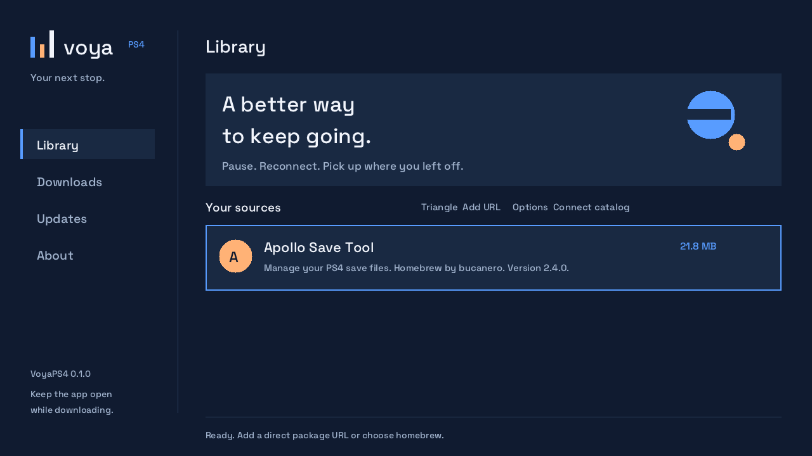

# VoyaPS4

A native PS4 homebrew download manager that keeps your place when your connection
drops. Add a direct package URL, download onto the console, pause or resume, and keep
your queue across relaunches.

**Firmware 13.50 / GoldHEN validation in progress.** Version 0.1.0 installed but failed
at launch; inspection found required OpenOrbis module stubs missing. Version 0.1.1
includes them, but console testing exposed a subsequent unsupported storage API
and CE-34878-0. The 0.1.2 candidate replaces that API and awaits console launch testing.
Native package builds and host transfer tests pass. This is
an independent project with an original interface, not an affiliated Gamebato client.



Native UI preview rendered from the app's drawing code, not a physical-console capture.

## Install

[Download VoyaPS4.pkg](https://github.com/Abodysoma2021/VoyaPS4/releases/latest/download/VoyaPS4.pkg)
or [view releases and checksums](https://github.com/Abodysoma2021/VoyaPS4/releases).

Use your existing homebrew loader's package installer. For an installer that accepts
direct URLs, use this link:

```text
https://github.com/Abodysoma2021/VoyaPS4/releases/latest/download/VoyaPS4.pkg
```

Alternatively copy the PKG to an exFAT USB drive and install using the loader's
package installer. Visiting the link in an ordinary PS4 browser does not by itself
install homebrew. A working loader is required; VoyaPS4 does not jailbreak the console.

## Controls

| Control | Action |
|---|---|
| L1 / R1 | Switch Library, Downloads, Updates, About |
| D-pad up/down | Select a package or download |
| X in Library | Queue the selected package |
| Triangle | Enter a direct HTTP/HTTPS PKG URL |
| Options | Set an HTTPS catalog URL |
| X in Downloads | Pause/resume, or confirm an installation request when ready |
| Circle in Downloads | Cancel; keep partial bytes for later resume |
| Square in Downloads | Restart a stopped download from zero; retain old partial as `.previous` |
| X in Updates | Check for a new app version |
| Triangle in Updates | Download the available update |

Keep VoyaPS4 open and your console awake. Interrupted active downloads retry with
exponential delays from 2 to 120 seconds. Relaunching resumes queued/interrupted
downloads. Paused and cancelled jobs stay stopped until you resume them.

Efficient resume requires a server with byte-range support. If a server ignores
Range/If-Range, the client restarts the transfer instead of appending a different
file. Catalog checksums are verified before installation; direct URLs without a
checksum are labeled as unverified. HTTPS verification stays enabled. A TLS error
requires fixing the source/certificates/console clock, not disabling verification.

## Sources and catalogs

The bundled catalog links to the original author's Apollo Save Tool release as a
homebrew example. Add your own authorized PS4 package URLs. VoyaPS4 does not include
commercial-game sources or bypass package encryption, DRM, licenses or firmware
requirements. It cannot acquire FC27 from PlayStation Store on your behalf.

Host a catalog like [assets/catalog.json](assets/catalog.json) over HTTPS and enter
its URL with Options. Schema 1 accepts at most 200 entries, each with `name`, `url`,
optional `description`, `source`, `size` in bytes and lowercase `sha256`. Use a
checksum whenever available. URLs must serve PKG bytes, not a download webpage,
login form, cloud-drive preview, torrent or split archive.

Data lives in `/data/voyaps4`: `queue.json`, generated-name `.pkg.part` files,
resume validators, completed `.pkg` files and optional catalog configuration.
There is a 100-job queue limit; this initial version keeps completed records and
packages. Copy/archive your data before maintenance; there is no in-app deletion.
Invalid queue metadata is preserved as `queue.recovery.json`.
Startup milestones and failures are recorded locally in `boot.log`, replaced on each
launch. No catalog URLs or credentials are logged. Read this file through FTP if startup fails.

## Updates

On launch, VoyaPS4 checks the official release's `update.json`. A higher semantic
version appears in Updates. Download it, select it in Downloads, and confirm staging.
The app verifies its digest and copies it to `/data/pkg/VoyaPS4-update.pkg`.
**Close VoyaPS4**, then use the loader's internal package installer to install that
file. Your saved queue and partial downloads survive app replacement.

For maintainers: update `VERSION` and `CHANGELOG.md`, then push main. CI tests,
builds and validates the PS4 package and publishes a new immutable versioned release.
Pushing code with an already released VERSION only builds; it never silently replaces
that release. Version tags are also supported. The updater accepts only HTTPS assets
under this repository's versioned release path with mandatory size and SHA-256.
It relies on TLS and your GitHub release account, not an independent signing key.

GitHub rejected the initial workflow run because Actions is disabled for this account.
Until that account restriction is resolved, publish a new version from a clean main
checkout using the same tested local builder:

```sh
tools/publish-release.sh /absolute/path/to/OpenOrbis/PS4Toolchain
```

This runs tests, builds and validates the package, pushes main, tags the current source,
and uploads the release assets. Bump VERSION first. Existing releases are never replaced.

## Develop

Host tests need a C++17 compiler, Python 3, make and libcurl development headers:

```sh
make test
make preview
```

`make preview` renders the same native UI to `build/preview-0.ppm` through
`preview-3.ppm`; the Downloads preview uses clearly synthetic progress data.

For PS4, download and extract [OpenOrbis v0.5.4](https://github.com/OpenOrbis/OpenOrbis-PS4-Toolchain/releases/tag/v0.5.4).
On macOS with Docker, keep the SDK under a Docker-shared directory such as your home:

```sh
tools/docker-build.sh /absolute/path/to/OpenOrbis/PS4Toolchain
```

The Docker image isolates the legacy packaging runtime. Output is `dist/VoyaPS4.pkg`,
`dist/update.json` and `dist/SHA256SUMS`. CI pins/verifies the SDK archive and vendored
dependencies. The SFO build number derives from the source commit history, so keep
main's history append-only. The app displays the semantic VERSION. Publish each VERSION
once. [Sources](docs/SOURCES.md),
[third-party licenses](docs/THIRD-PARTY.md), [console checklist](docs/CONSOLE-TESTING.md).

GPL-3.0-or-later. See LICENSE.
